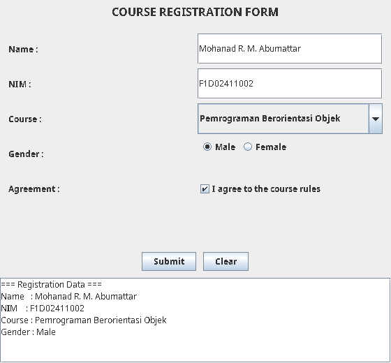

# GUI Exploration — Java Swing

**NIM:** F1D02411002
**Name:** Mohanad R. M. Abumattar
**Class:** 5A — Pemrograman Berorientasi Objek (Object Oriented Programming)
**Topic:** Self Exercise / Exploration of Graphical User Interface in Java

## About the Program

`GuiExploration.java` is a simple **Student Course Registration Form** built with Java Swing. The user fills in a name, NIM, course, and gender, ticks the agreement checkbox, and presses **Submit** — the registration data is then printed into the output area at the bottom. **Clear** resets the whole form. The code is a single self-contained file with no external libraries.

## How to Run

```bash
javac GuiExploration.java
java GuiExploration
```

## The 5 GUI Components / Parts

### 1. Top Level Container Class
- **JFrame** — the main window. The class `GuiExploration` extends `JFrame`, sets the window title, size (560x520), and position.

### 2. Intermediate Container Class
- **JPanel** — used five times to group related components:
  - `titlePanel` (holds the title label)
  - `formPanel` (holds the input fields)
  - `genderPanel` (holds the radio buttons, nested inside the form)
  - `buttonPanel` (holds the Submit and Clear buttons)
  - `southPanel` (holds the button panel and the output area)
- **JScrollPane** — wraps the output text area so it can scroll.

### 3. Atomic Component Class
The smallest, indivisible components the user interacts with:
- `JLabel` (field labels and the title), `JTextField` (name and NIM input),
  `JComboBox` (course selection), `JRadioButton` (gender, grouped with a
  `ButtonGroup`), `JCheckBox` (agreement), `JButton` (Submit and Clear), and
  `JTextArea` (output display).

### 4. Layout Classes (3 layouts used, minimum was 2)
- **BorderLayout** — the main window layout (title NORTH, form CENTER, buttons + output SOUTH).
- **GridLayout** — the form panel (6 rows x 2 columns, labels beside their fields).
- **FlowLayout** — the title panel, gender panel, and button panel (components in a row).

### 5. Event Listener
Three listener styles are demonstrated:
- **ActionListener (interface)** — the inner class `ButtonHandler` implements `ActionListener` and overrides `actionPerformed(...)` to handle the Submit and Clear buttons (including input validation with `JOptionPane` dialogs).
- **MouseAdapter (adapter class)** — an anonymous `MouseAdapter` overrides `mouseEntered(...)` / `mouseExited(...)` to highlight the Submit button when the mouse hovers over it.
- **WindowAdapter (adapter class)** — overrides `windowClosing(...)` to show an exit-confirmation dialog before the window closes.

## Screenshot



The screenshot shows the registration form after one successful submission: the entered data (name, NIM, selected course, gender) is printed in the output area at the bottom of the window.
